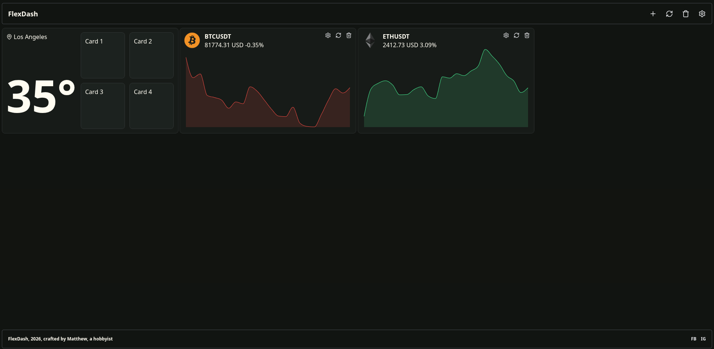
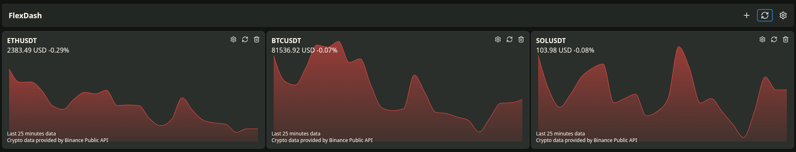
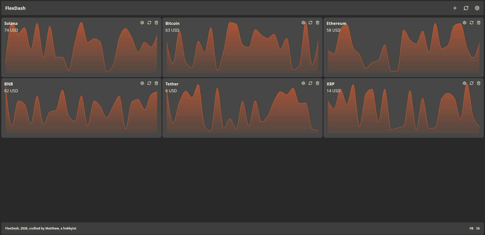
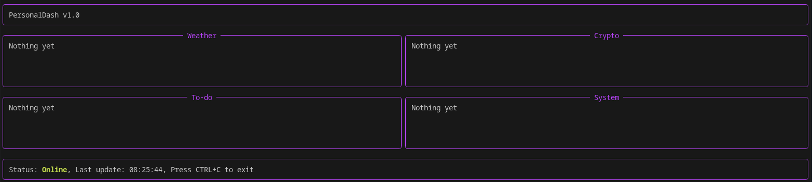

# PersonalDashboard

A personal dashboard built with **Python and Reflex**, bringing everyday widgets together in one website.

PersonalDashboard aims to provide a convenient place to access useful tools and information, including weather, cryptocurrency, to-do lists, and system information.

## Features

- **Crypto Cards** — Create, edit, refresh, and delete cryptocurrency cards with price graphs.
- **Weather Cards** — Create, edit, refresh and delete weather cards with its data

> **Note:** PersonalDashboard is currently under development. Some widgets are still placeholders.

---

## Development Timeline

### PersonalDashboard V1.17 Latest

#### 7. Weather Card · V1.17 `4h 42m`

**October 23/24 , 2026**

Weather cards are now connected to real world API, provided by Open-Meteo API,

Weather cards now have four small cards inside, which are "Feels Like", "Humidity", "Wind Speed" and "Cloud Cover

Weather cards have same buttons at top right like cryptocurrency cards, which are settings, reload and delete

#### 6. Updated Crypto and Weather Card · V1.13 `5h 24m`

**October 22, 2026**

Removes cryptocurrency live market prices card. As it is too complicated for me

Introduces weather card, now still in random data state, will connect to public api in the next update

Updated crypto card, now graphs color will react to price changes, there is also icons for them

#### 5. Real Live Market Data · V.1.12 `3h 34m`

**October 21, 2026**

Introduced real live market prices on cryptocurrency cards.

Users now edit the name to correct symbol eg:"BTCUSDT","SOLUSDT". It will pull data from Binance WebSocket Stream.

At this stage, the cryptocurrency cards can now pull live data with no delay, by using Live Crypto Card in "+"

It is still in beta as code doesn really works.

#### 4. Real Live Market Data · V1.11 `3h 39m`

**October 20, 2026**

Introduced real live market prices on cryptocurrency cards.

Users now edit the name to correct symbol eg:"BTCUSDT","SOLUSDT". It will pull data from Binance Public API.

At this stage, the cryptocurrency cards now have 5 seconds cooling time, to prevent rate-limited by Binance Public API.

The reload button at the top right works now, click to reload all card.

#### 3. Interactive Crypto Cards · V1.10 `3h 28m`

**October 19, 2026**

Introduced interactive cryptocurrency cards.

Users can click **Add Crypto Card** to create a new card containing a graph, a name initially set to `NaN`, and a displayed number.

At this stage, the cards were still under development, with more interactive features planned.

#### 2. Migration from Rich to Reflex · V1 `6h 45m`

**October 18, 2026** 

Moved the project from a terminal-based interface using Rich to a web-based interface using Reflex.

#### 1. Initial Layout · V1 `1h 3m`

**October 17, 2026** 

Built the initial dashboard layout with four panels:

- Weather
- Crypto
- To-Do
- System

At this stage, all four panels displayed *"Nothing yet"*. The plan was to connect them to real data through `api.py`.

---

## Tech Stack

- **Python** — Application logic and backend
- **Reflex** — Python-based web application framework
- **Binance API** — API used for all crypto prices data, symbol data
- **Cryptocurrency_Logos** — Source of cryptocurrency logos, see [Github Repository](https://github.com/Pymmdrza/Cryptocurrency_Logos)
- **World Cities Database by simplemaps** — Source of world cities query (Converted from .csv to .sqlite3), see [simplemaps](https://simplemaps.com/data/world-cities)
- **Open-Meteo API** — Source of weather data, see [Open-Meteo website](https://open-meteo.com/), [Open-Meteo terms](https://open-meteo.com/en/terms)

## 📌 Project Status

**PersonalDashboard is under active development.**

Features and layouts may change as the project evolves.

---

*Built with Python and Reflex.*
