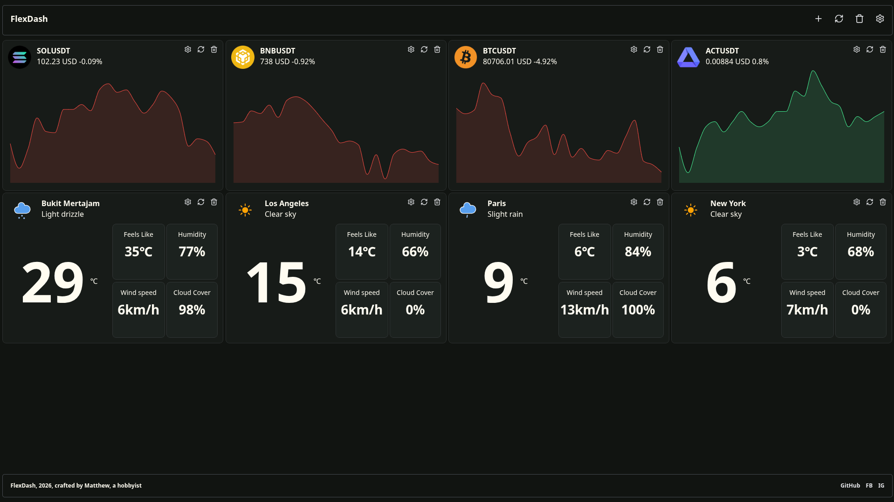

# PersonalDashboard

A website built with **Python Reflex**, includes daily needed widget.

## Features
- **Crypto** - Shows real market data in form of graph using Binance API
- **Weather** - Shows real weather data with four little card using Open-Meteo API.

## Versions
- Personal Dashboard V2  , Latest, Under Development
- Personal Dashboard V1  , Released: [Website Link](http://relaymatthew.duckdns.org:65502)
- Personal Dashboard Beta, Released: [Website Link](http://relaymatthew.duckdns.org:65501/)

## How to run locally (Linux only)
- Supported python versions : 3.11, 3.12, 3.13, 3.14 . Recommended 3.14
- Make sure you have **python** and **git** installed  
- Run command below 

**Personal Dashboard Beta:**
  ```bash 
  git clone https://github.com/matthew-teh/PersonalDash.git
  cd PersonalDash
  git checkout 8b1d5b7c279e807a0b755b27cc1fe3dd21ea8e52
  curl -LsSf https://astral.sh/uv/install.sh | sh  # Install UV
  uv add reflex
  uv run reflex run
  ```
  
**Personal Dashboard V1:**
  ```bash
  git clone https://github.com/matthew-teh/PersonalDash.git
  cd PersonalDash
  git checkout 05a6fd8e5769cb36a0944308589637a7759f0b08
  curl -LsSf https://astral.sh/uv/install.sh | sh   # Install UV
  uv add reflex requests openmeteo-requests
  uv run reflex run
  ```
Personal Dashboard V1 Only:  
1. `git clone https://github.com/Pymmdrza/Cryptocurrency_Logos.git`
2. Copy the folder PNG to PersonalDash/assets
3. Rename the folder to `cryptoimages`
4. `git clone https://github.com/Makin-Things/weather-icons`
5. Copy the folder `animated` to PersonalDash/assets
6. Rename the folder to `weatherimages`
7. Delete original folder of `weather-icons` and `Cryptocurrency_Logos`

## Screenshots



## Credits and Attribute
- **Binance API** - API used for all crypto prices data, symbol data
- **Cryptocurrency_Logos** - Source of cryptocurrency logos, see [Github Repository](https://github.com/Pymmdrza/Cryptocurrency_Logos)
- **World Cities Database by simplemaps** - Source of world cities query (Converted .csv to .sqlite3), [simplemaps](https://simplemaps.com/data/world-cities)
- **Open-Meteo API** - Source of weather data, [Open-Meteo website](https://open-meteo.com/), [Open-Meteo terms](https://open-meteo.com/en/terms)
- **Weather Icons** - Source of weather icons, [Weather Icons](https://github.com/Makin-Things/weather-icons)
- **World Clock Icons** - Images used in world clock widget, [Image website](https://pixabay.com/vectors/global-earth-world-map-globe-1889726/)
- **Opentimezone** - Source of timezones, downloaded one file, [TimeZones](https://api.opentimezone.com/timezones) [Github repository](https://github.com/ashtonav/opentimezone)

## AI Disclosure
This project was helped by Gemini to fix little bugs. `AGENTS.md` and `CLAUDE.md` is automatically generated by Reflex Python cannot be deleted.

## Stack
- **Python** — Application logic and backend
- **Reflex** — Python-based web application framework
