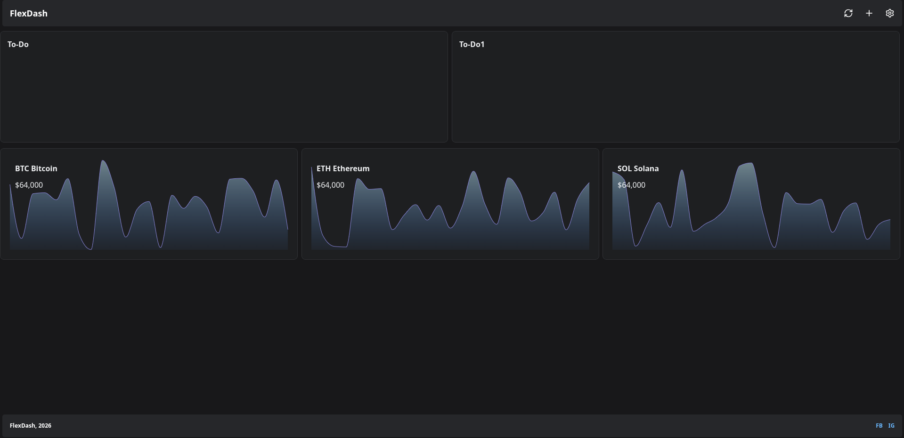

# PersonalDashboard

A personal dashboard built with **Python and Reflex**, bringing everyday widgets together in one website.

PersonalDashboard aims to provide a convenient place to access useful tools and information, including weather, cryptocurrency, to-do lists, and system information.

## Features

- **Crypto Cards** — Create, edit, refresh, and delete cryptocurrency cards with price graphs.

> **Note:** PersonalDashboard is currently under development. Some widgets are still placeholders.

---

## Development Timeline

### PersonalDashboard Beta

#### 1. Initial Layout

**October 17, 2026** · `1h 3m`

Built the initial dashboard layout with four panels:

- Weather
- Crypto
- To-Do
- System

At this stage, all four panels displayed *"Nothing yet"*. The plan was to connect them to real data through `api.py`.

#### 2. Migration from Rich to Reflex · `6h 45m`

**October 18, 2026** 

Moved the project from a terminal-based interface using Rich to a web-based interface using Reflex.

#### 3. Interactive Crypto Cards · `3h 28m`

**October 19, 2026**

Introduced interactive cryptocurrency cards.

Users can click **Add Crypto Card** to create a new card containing a graph, a name initially set to `NaN`, and a displayed number.

At this stage, the cards were still under development, with more interactive features planned.

#### 4. Real Live Market Data · `3h 39m`

**October 20, 2026**

Introduced real live market prices on cryptocurrency cards.

Users now edit the name to correct symbol eg:"BTCUSDT","SOLUSDT". It will pull data from Binance Public API.

At this stage, the cryptocurrency cards now have 5 seconds cooling time, to prevent rate-limited by Binance Public API.

The reload button at the top right works now, click to reload all card.

---

## Tech Stack

- **Python** — Application logic and backend
- **Reflex** — Python-based web application framework
- **Binance API** — API used for all crypto prices data, symbol data

## 📌 Project Status

**PersonalDashboard is under active development.**

Features and layouts may change as the project evolves.

---

*Built with Python and Reflex.*
