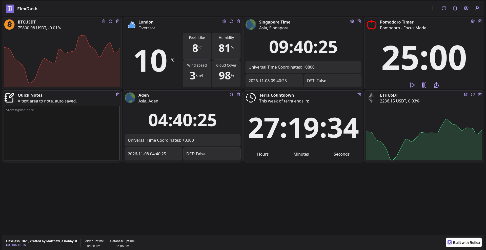

# PersonalDashboard

A website built with **Python Reflex**, includes daily needed widget.

## Features 
- **Crypto** - Shows real market data in form of graph using Binance API
- **Weather** - Shows real weather data with four little card using Open-Meteo API.
- **World Clock** - Display live time of a city, auto refresh.
- **Pomodoro TImer** - Pomodoro based timer that let you focus
- **Tic Tac Toe** - A mini game that can played with computer, based on Terra week theme: ANTIQUE 8 bit game
- **Quick Notes** - A blank space for you to type anything
- **Terra countdown** - Shows how much hours you have left to code and ship.

## Versions
- Personal Dashboard V3  , Latest Relased : [Website Link](https://flexdasboard.xyz)
- Personal Dashboard V2  , Released: [Website Link](http://relaymatthew.duckdns.org:65503)
- Personal Dashboard V1  , Released: [Website Link](http://relaymatthew.duckdns.org:65502)
- Personal Dashboard Beta, Released: [Website Link](http://relaymatthew.duckdns.org:65501)

## How to run locally (Linux only)
- SEE [Running.md](RUNNING.md)

## Website Preview

## Credits and Attribute
- **Binance API** - API used for all crypto prices data, symbol data
- **Cryptocurrency_Logos** - Source of cryptocurrency logos, see [Github Repository](https://github.com/Pymmdrza/Cryptocurrency_Logos)
- **World Cities Database by simplemaps** - Source of world cities query (Converted .csv to .sqlite3), [simplemaps](https://simplemaps.com/data/world-cities)
- **Open-Meteo API** - Source of weather data, [Open-Meteo website](https://open-meteo.com/), [Open-Meteo terms](https://open-meteo.com/en/terms)
- **Weather Icons** - Source of weather icons, [Weather Icons](https://github.com/Makin-Things/weather-icons)
- **World Clock Icons** - Images used in world clock widget, [Image website](https://pixabay.com/vectors/global-earth-world-map-globe-1889726/)
- **Opentimezone** - Source of timezones, downloaded one file, [TimeZones](https://api.opentimezone.com/timezones) [Github repository](https://github.com/ashtonav/opentimezone)
- **Lucide Icons** - Source of some cards icon, downloaded icon's svg.

## AI Disclosure
This project was helped by Gemini to fix little bugs. `AGENTS.md` and `CLAUDE.md` is automatically generated by Reflex Python cannot be deleted.

## Stack
- **Python** — Application logic and backend
- **Reflex** — Python-based web application framework
